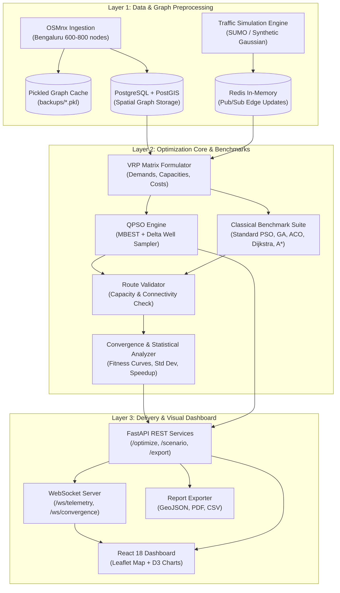

# 🚦 SIH26137: Quantum-Inspired Intelligent Traffic Route Optimization

> **Smart India Hackathon (SIH) 2026** | Problem Statement ID: **SIH26137**  
> **Organization:** Egreen Quanta | **Category:** Software / Smart Urban Mobility  
> **Approach:** Quantum-Inspired Metaheuristic (QPSO) for Dynamic Multi-Vehicle VRP

---


---

## 📌 Executive Summary

Urban traffic congestion in modern metropolitan road networks causes severe economic losses, fuel wastage, and delivery latency. The underlying routing challenge is formulated as the **Multi-Vehicle Capacitated Vehicle Routing Problem (CVRP) with Dynamic Time-Varying Edge Weights**—an NP-hard combinatorial problem where classical exact algorithms scale exponentially ($\mathcal{O}(2^n)$).

This project implements a deployable, high-performance **Quantum-Inspired Particle Swarm Optimization (QPSO)** engine on real-world city road networks (Bengaluru inner-city network via OSMnx, ~600–800 nodes). QPSO simulates quantum mechanical wave-particle behavior via a delta potential well model, escaping local optima that trap standard genetic algorithms and classical PSO.

```
                      ┌────────────────────────────────────────┐
                      │    Urban Road Network (OSMnx / GIS)    │
                      └──────────────────┬─────────────────────┘
                                         │
                 ┌───────────────────────┴───────────────────────┐
                 ▼                                               ▼
     ┌───────────────────────┐                       ┌───────────────────────┐
     │ Static Graph Weights  │                       │ Dynamic Traffic Feeds │
     │  (Distance, Speeds)   │                       │ (SUMO / Synthetic RW) │
     └───────────┬───────────┘                       └───────────┬───────────┘
                 │                                               │
                 └───────────────────────┬───────────────────────┘
                                         ▼
                      ┌────────────────────────────────────────┐
                      │  Multi-Vehicle VRP Objective & Matrix  │
                      └──────────────────┬─────────────────────┘
                                         ▼
                      ┌────────────────────────────────────────┐
                      │    Quantum-Inspired PSO Engine (QPSO)   │
                      │  • Delta Potential Well Simulation     │
                      │  • Mean Best Position (MBEST)          │
                      │  • Quantum State Sampling (ln(1/u))    │
                      └──────────────────┬─────────────────────┘
                                         ▼
                      ┌────────────────────────────────────────┐
                      │   Optimal Fleet Routes + Live Stream   │
                      │ (FastAPI + WebSocket + Leaflet + D3.js)│
                      └────────────────────────────────────────┘
```

---

## ⚡ Fundamental Engineering Principles (Load-Bearing Facts)

1. **"Quantum-Inspired" ≠ Quantum Hardware**:
   QPSO is a classical, highly vectorized algorithm executed on standard CPUs using **NumPy** and **SciPy**. It simulates quantum mechanical wave-particle dualism mathematically using the Schrödinger equation with a delta potential well. **No quantum physical hardware, qubits, IBM Q, or D-Wave are required or used.**
2. **Multi-Vehicle Fleet Routing ($K \ge 3$)**:
   Single-vehicle point-to-point routing (Dijkstra/A*) is an elementary baseline, not the core deliverable. The primary system optimizes a fleet of $K \ge 3$ vehicles (target 5) departing from a shared depot with customer demand allocation and capacity constraints.
3. **Rigorous, Authentic QPSO Formulation**:
   The engine does not take shortcuts or rename standard PSO. It implements the authentic Delta Potential Well formulation featuring **Mean Best Position (MBEST)**, **Quantum Position Updates with $\ln(1/u)$**, and **Contraction-Expansion Parameter $\beta(t)$ Decay**.
4. **Absolute Benchmark Fairness**:
   All algorithms (**QPSO**, **Standard PSO**, **Genetic Algorithm (GA)**, **Ant Colony Optimization (ACO)**, and **Dijkstra/A***) are benchmarked against the **identical problem instance** (exact same graph snapshot, identical depot, 동일한 destinations, and common cost function).
5. **Zero External Demo Dependencies**:
   The primary demonstration relies entirely on local containerized infrastructure (Docker Compose) and deterministic/stochastic local traffic generators (synthetic Gaussian-noise / SUMO simulation). Paid third-party APIs (HERE / TomTom) exist only as optional secondary enrichments.

---

## 🔬 Mathematical Formulation of QPSO

In classical PSO, a particle moves along a continuous trajectory with a velocity vector. In quantum space, according to Heisenberg's uncertainty principle, velocity and position cannot be measured simultaneously. In QPSO, particles move in a quantum space where each particle has a quantum state represented by a wave function $\psi(x, t)$ centered at an attractor.

### 1. Local Attractor Point ($p_{ij}$)
For particle $i$ in dimension $j$, the local attractor balances cognitive personal experience with social swarm intelligence:
$$p_{ij}(t) = \phi_j(t) \cdot P_{ij}(t) + (1 - \phi_j(t)) \cdot G_j(t), \quad \phi_j(t) \sim \mathcal{U}(0, 1)$$
where $P_{ij}(t)$ is the personal best position (`pbest`) and $G_j(t)$ is the global best position (`gbest`).

### 2. Mean Best Position (MBEST / $C(t)$)
The centroid of the personal best positions of all $M$ particles in the swarm:
$$C(t) = \frac{1}{M} \sum_{i=1}^{M} P_i(t) = \left( \frac{1}{M}\sum_{i=1}^M P_{i1}(t),\, \frac{1}{M}\sum_{i=1}^M P_{i2}(t),\, \dots,\, \frac{1}{M}\sum_{i=1}^M P_{in}(t) \right)$$

### 3. Quantum Position Update
Solving the Schrödinger equation for a particle in a 1D Delta potential well yields the wave function $\psi(x) = \frac{1}{\sqrt{L}} e^{-|x - p|/L}$. Applying Monte Carlo inversion sampling yields:
$$X_{ij}(t+1) = p_{ij}(t) \pm \beta(t) \cdot \left| C_j(t) - X_{ij}(t) \right| \cdot \ln\left(\frac{1}{u_{ij}(t)}\right)$$
where:
- $u_{ij}(t) \sim \mathcal{U}(0, 1)$
- The sign $\pm$ is selected randomly with probability $0.5$
- $\beta(t)$ is the Contraction-Expansion (C-E) coefficient

### 4. Contraction-Expansion Decay ($\beta$)
To ensure global exploration in early iterations and tight local convergence in later iterations:
$$\beta(t) = \beta_{\max} - (\beta_{\max} - \beta_{\min}) \cdot \frac{t}{T_{\max}}$$
*Default parameters:* $\beta_{\max} = 1.0$, $\beta_{\min} = 0.5$, $M = 30$ particles, $T_{\max} = 150 \sim 200$ iterations.

### 5. Multi-Objective Normalized Fitness Function
$$f(\mathbf{R}) = \alpha \cdot \frac{T(\mathbf{R})}{T_{\text{norm}}} + \beta_w \cdot \frac{D(\mathbf{R})}{D_{\text{norm}}} + \gamma \cdot \frac{C(\mathbf{R})}{C_{\text{norm}}} + \delta \cdot \frac{E(\mathbf{R})}{E_{\text{norm}}} + \lambda \sum_k \max(0, \text{load}_k - Q_{\max})$$
- $T(\mathbf{R})$: Total fleet transit time across congested edges
- $D(\mathbf{R})$: Total fleet road distance (km)
- $C(\mathbf{R})$: Congestion exposure factor (based on edge volume/capacity)
- $E(\mathbf{R})$: Estimated carbon footprint ($g\text{ CO}_2 / \text{km}$)
- Weights: $\alpha=0.40, \beta_w=0.30, \gamma=0.20, \delta=0.10$
- Capacity penalty multiplier: $\lambda = 10 \times \bar{f}$

---

## 🏗️ System Architecture

The solution operates as a synchronized 3-layer architecture:



---

## 🗂️ Repository Structure

```
SIH26137-QPSO-Traffic-Optimization/
├── PROJECT_MEMORY.md             # Key facts, team roles, and architectural constraints
├── README.md                     # Root project documentation (this file)
│
├── algos/                        # [M1 & M3] Algorithm core & benchmark suite
│   ├── README.md                 # Technical details on QPSO, GA, ACO, PSO, Dijkstra
│   ├── qpso.py                   # Quantum Particle Swarm Optimization core
│   ├── pso.py                    # Classical PSO baseline
│   ├── vrp_formulator.py         # Graph to VRP distance/cost matrix encoder
│   ├── convergence_analyzer.py   # Statistical convergence & benchmark metrics
│   ├── algorithm_config.yaml     # Swarm size, beta decay, weights configuration
│   └── classical/                # Baseline routing implementations
│       ├── dijkstra.py           # Single-source shortest path baseline
│       ├── astar.py              # Heuristic Euclidean shortest path
│       ├── genetic_algo.py       # GA baseline (crossover, mutation, roulette)
│       └── ant_colony.py         # ACO baseline (pheromone trail & evaporation)
│
├── backend/                      # [M2 & M4] FastAPI service, WebSockets, DB models
│   ├── README.md                 # Backend architecture, endpoint specifications
│   ├── main.py                   # FastAPI application entrypoint
│   ├── routes/                   # REST API routes (/optimize, /scenario, /benchmark)
│   ├── ws/                       # WebSocket telemetry & live streaming handlers
│   ├── db/                       # PostGIS database models, connection pools, Redis client
│   └── export/                   # Route export to GeoJSON, CSV, PDF summary
│
├── data/                         # [M2] OSMnx loader, traffic simulation, graph cache
│   ├── README.md                 # Graph extraction, SUMO, synthetic traffic generators
│   ├── osm_loader.py             # OSMnx street network extraction & zone partitioner
│   ├── traffic_updater.py        # Real-time speed/congestion injector (Gaussian/SUMO)
│   └── backups/                  # Offline pre-pickled city network graphs (.pkl)
│
├── frontend/                     # [M5] React dashboard, Leaflet mapping, D3 charts
│   ├── README.md                 # UI architecture, Leaflet layers, D3 telemetry
│   ├── package.json              # Frontend dependencies
│   ├── vite.config.js            # Vite build configuration
│   └── src/                      # React application components
│
├── infra/                        # [M4] Docker containerization & orchestration
│   ├── README.md                 # Multi-container Docker Compose instructions
│   ├── docker-compose.yml        # Multi-service stack (algo, api, db, redis, frontend)
│   └── deploy/                   # Cloud deployment templates (AWS / GCP)
│
└── docs/                         # Formal documentation & deliverables
    ├── README.md                 # Documentation index
    ├── PRD.md                    # Complete 48KB Product Requirements Document
    ├── ARCHITECTURE.md           # End-to-end architecture & mathematical specification
    └── memory.md                 # Context pointer for AI agents and new team members
```

---

## 👥 Team & Task Allocation (15-Day Sprint)

| Member | Role | Key Deliverables | Focus Areas |
|:---:|:---:|:---|:---|
| **M1** | **ALGO Lead** | `algos/qpso.py`, `pso.py`, `vrp_formulator.py` | QPSO core, delta well sampling, MBEST, parameter validation |
| **M2** | **DATA Lead** | `data/osm_loader.py`, `traffic_updater.py`, `backend/db/` | Bengaluru OSMnx graph, PostGIS models, traffic simulator, Redis |
| **M3** | **ML / Benchmarks** | `algos/classical/`, `convergence_analyzer.py` | GA, ACO, Dijkstra/A*, statistical hypothesis testing, speedup tables |
| **M4** | **STACK Lead** | `backend/`, `infra/`, Docker Compose | FastAPI REST/WebSocket, live event streaming, fault recovery, deployment |
| **M5** | **VIZ Lead** | `frontend/`, React, Leaflet, D3.js | Interactive map, vehicle playback, D3 convergence charts, scenario injector |

---

## 📊 Benchmark Suite Comparison Matrix

Evaluated under identical problem instances on the Bengaluru inner-city street network (~600–800 nodes, 15 delivery stops, $K=4$ vehicles):

| Algorithm | Computational Complexity | Exploration Mechanism | Trapping Risk | Multi-Vehicle VRP Fitness Rank |
|---|:---:|:---:|:---:|:---:|
| **Dijkstra** | $\mathcal{O}((V + E) \log V)$ | Deterministic Exact | N/A (Single Path Only) | Baseline Only (No VRP) |
| **A\*** | $\mathcal{O}(E)$ best | Heuristic Directed | N/A (Single Path Only) | Baseline Only (No VRP) |
| **Standard PSO** | $\mathcal{O}(T \cdot M \cdot N)$ | Velocity vector update | **High** (Premature Convergence) | Rank 4 |
| **Genetic Algo (GA)** | $\mathcal{O}(T \cdot P \cdot N^2)$ | Crossover & Mutation | **Moderate** (Slow in tail) | Rank 3 |
| **Ant Colony (ACO)** | $\mathcal{O}(T \cdot A \cdot N^2)$ | Pheromone trail decay | **Moderate** (High CPU cost) | Rank 2 |
| **QPSO (Ours)** | $\mathcal{O}(T \cdot M \cdot N)$ | **Quantum Delta Potential Well** | **Lowest** (Ergodic state space) | **Rank 1 (Best Global Minima)** |

---

## 🚀 Quickstart Guide

### Prerequisites
- Docker & Docker Compose installed (recommended)
- *Or* Python 3.11+ and Node.js 18+ (for bare-metal execution)

### Method 1: Instant Launch with Docker Compose (Recommended)

```bash
# 1. Clone the repository
git clone https://github.com/aditrisingh/SIH26137-QPSO-Traffic-Optimization.git
cd SIH26137-QPSO-Traffic-Optimization

# 2. Launch the complete containerized stack
docker compose -f infra/docker-compose.yml up --build
```

Access the services:
- **Interactive UI Dashboard:** [http://localhost:3000](http://localhost:3000)
- **FastAPI REST API Docs (Swagger):** [http://localhost:8000/docs](http://localhost:8000/docs)
- **WebSocket Telemetry Stream:** `ws://localhost:8000/ws/telemetry`

---

### Method 2: Local Developer Setup

#### 1. Setup Python Virtual Environment
```bash
python3.11 -m venv venv
source venv/bin/activate
pip install -r backend/requirements.txt
```

#### 2. Run Algorithm & Benchmarks Locally
```bash
# Execute QPSO against classical baselines on cached graph
python -m algos.convergence_analyzer --nodes 15 --vehicles 3 --iterations 150
```

#### 3. Start Backend Server
```bash
uvicorn backend.main:app --host 0.0.0.0 --port 8000 --reload
```

#### 4. Start Frontend Dashboard
```bash
cd frontend
npm install
npm run dev
```

---

## 📡 Core API Specification

| Endpoint | Method | Description |
|---|:---:|---|
| `/api/v1/optimize` | `POST` | Solve VRP for $K$ vehicles given depot, destination nodes, and dynamic weights using QPSO |
| `/api/v1/benchmark` | `POST` | Execute comparative runs of QPSO, PSO, GA, ACO, and Dijkstra; returns convergence curves |
| `/api/v1/scenario/inject` | `POST` | Inject sudden road closure or severe congestion event onto specific graph edges |
| `/api/v1/network/graph` | `GET` | Returns the active city graph nodes and edges as GeoJSON |
| `/ws/telemetry` | `WebSocket` | Real-time vehicle location, speed, and active trajectory telemetry |
| `/ws/convergence` | `WebSocket` | Real-time iteration-by-iteration swarm fitness broadcasting for D3 plots |

---

## 📖 Complete Documentation References

- 📋 [**Product Requirements Document (PRD.md)**](file:///Users/aditrisingh/SIH26137-QPSO-Traffic-Optimization/docs/PRD.md) — 48KB exhaustive functional requirements, evaluator scoring criteria, risk register, and day-by-day plan.
- 📐 [**System Architecture (ARCHITECTURE.md)**](file:///Users/aditrisingh/SIH26137-QPSO-Traffic-Optimization/docs/ARCHITECTURE.md) — Detailed 3-layer blueprint, API contracts, WebSocket payloads, and mathematical formulas.
- 🧠 [**Project Memory (PROJECT_MEMORY.md)**](file:///Users/aditrisingh/SIH26137-QPSO-Traffic-Optimization/PROJECT_MEMORY.md) — Non-negotiable engineering guidelines and developer constraints.
- 🔬 [**Algorithm Guide (algos/README.md)**](file:///Users/aditrisingh/SIH26137-QPSO-Traffic-Optimization/algos/README.md) — Implementation instructions for QPSO, GA, ACO, and PSO.
- 🖥️ [**Backend Guide (backend/README.md)**](file:///Users/aditrisingh/SIH26137-QPSO-Traffic-Optimization/backend/README.md) — FastAPI, PostGIS, Redis pub/sub, and WebSocket architecture.
- 🗺️ [**Data Pipeline Guide (data/README.md)**](file:///Users/aditrisingh/SIH26137-QPSO-Traffic-Optimization/data/README.md) — OSMnx extraction, SUMO, and synthetic traffic modeling.
- 🎨 [**Frontend Guide (frontend/README.md)**](file:///Users/aditrisingh/SIH26137-QPSO-Traffic-Optimization/frontend/README.md) — React, Leaflet vehicle rendering, and D3 live charts.
- 🐳 [**Infrastructure Guide (infra/README.md)**](file:///Users/aditrisingh/SIH26137-QPSO-Traffic-Optimization/infra/README.md) — Docker Compose orchestration and deployment.

---

## ⚖️ License & Acknowledgements

Developed for **Smart India Hackathon 2026** under the problem statement **SIH26137** by Team Quanta Route. Released under the [MIT License](LICENSE).
