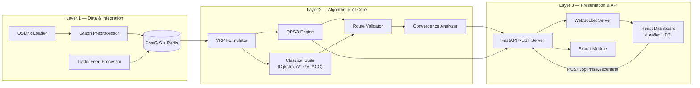

# Architecture — SIH26137: Quantum-Inspired Traffic Route Optimization

Version: v1.0 | Companion to `PRD.md` | Source: Sections 10 & 11 of the PRD, expanded for implementation

---

## 1. High-Level Overview

Three-layer stack: **Data & Integration → Algorithm & AI Core → Presentation & API**.



---

## 2. Layer 1 — Data & Integration

| Component | Responsibility | Tech |
|---|---|---|
| OSMnx Road Network Loader | Fetch city graph, convert to `NetworkX.DiGraph`. Nodes = intersections (lat/lon); edges = roads (length, speed_limit, lanes). | OSMnx, NetworkX |
| Traffic Weight Updater | Consume scenario events; update `traffic_factor` per edge; recompute effective weight; publish to Redis. | Redis pub/sub |
| Graph Preprocessor | Normalize weights [0,1]; isolate disconnected components; build R-Tree spatial index; export adjacency matrix. | NetworkX, Rtree |
| Data Store | Persist graph, historical routes, scenario logs. | PostgreSQL + PostGIS |
| Backup Loader | Fallback to precomputed local pickle if OSM/network is unavailable — zero network dependency. | Python `pickle` |

**Effective edge weight formula:**
```
weight = base_distance × speed_factor × traffic_factor × emission_factor
```

**Backup graphs (precomputed, Day 11 onward):** Bengaluru (primary, ~600–800 nodes), Delhi inner city, Mumbai CBD — stored as local pickles for offline, multi-city demo capability.

---

## 3. Layer 2 — Algorithm & AI Core

### 3.1 VRP Formulator
- Depot node, K vehicles, N delivery nodes.
- Per-vehicle capacity constraint; optional time windows.
- Output: K ordered node sequences, shared input contract for all 4 algorithms (fairness requirement — see §3.4).

### 3.2 QPSO Engine (core differentiator)
- Particle = full K-route assignment, encoded via **Smallest Position Value (SPV)** rule to map continuous QPSO positions to a discrete permutation.
- Quantum position update (see `Section 5 — QPSO Math` below) computed every iteration.
- Repair operator (cheapest insertion / node swap) applied post-update to fix unvisited/duplicated nodes.
- Streams `best_fitness` and current best route set every 5 iterations.
- Config surface: `algorithm_config.yaml` (swarm size, β schedule, fitness weights, iteration cap).

### 3.3 Classical Algorithm Suite (baselines)
| Algorithm | Role | Key Params |
|---|---|---|
| Dijkstra | Exact single-vehicle baseline | — |
| A* | Heuristic single-vehicle baseline | Euclidean heuristic |
| Genetic Algorithm | Classical metaheuristic baseline | population=50, PMX crossover, swap mutation |
| Ant Colony Optimization | Classical metaheuristic baseline | ants=30, evaporation ρ=0.2 |

### 3.4 Benchmark Validity Contract (critical)
All 4 algorithms **must** consume the identical VRP instance: same graph snapshot, same depot/destinations, same constraints, same fitness function, same random-seed protocol (30 repetitions each) — otherwise the comparison is invalid and evaluators will flag it.

### 3.5 Convergence Analyzer
- Logs `(iteration, best_fitness, mean_fitness, diversity)` per run.
- Runs 30 repetitions per algorithm for statistical significance.
- Computes mean ± std, convergence speed (iterations to reach 95% of final quality), and a Wilcoxon significance test (QPSO vs GA).
- Emits `matplotlib` charts + JSON for the export module and the live D3 chart.

### 3.6 Route Validator
- Confirms K≥3 vehicles, capacity satisfied, all destinations visited exactly once, no disconnected segments before a route is surfaced to the API layer.

---

## 4. Layer 3 — Presentation & API

### 4.1 REST Endpoints
| Method | Path | Purpose |
|---|---|---|
| POST | `/optimize` | Trigger a VRP solve (QPSO, optionally full benchmark) |
| POST | `/scenario` | Inject a traffic event (normal / rush / accident / closure / event) |
| GET | `/graph` | Fetch city graph as GeoJSON |
| GET | `/benchmark` | Trigger/fetch all-algorithm comparison |
| GET | `/routes/history` | Route log, filterable |
| GET | `/analytics/hotspots` | Top congested edges (GeoJSON) |
| POST | `/export/report` | Generate PDF benchmark report |
| GET | `/export/routes` | Route data as GeoJSON |

### 4.2 WebSocket Channels
| Channel | Payload | Cadence |
|---|---|---|
| `/ws/routes` | Best route set (per vehicle, ordered nodes) | Every 5 QPSO iterations |
| `/ws/convergence` | `(iteration, fitness)` per algorithm | Every iteration |
| `/ws/traffic` | Edge weight deltas | On scenario trigger |

### 4.3 Frontend Layout (React + Leaflet + D3)
- **Left panel** — controls: city selector, vehicle count, depot/destination pickers, scenario buttons.
- **Center** — Leaflet map: color-coded route polylines per vehicle, animated vehicle icons, congestion heat overlay.
- **Right panel** — 4-column algorithm comparison table (QPSO / PSO / GA / ACO): travel time, distance, congestion score, runtime.
- **Bottom panel** — D3.js real-time convergence animation (one line per algorithm).

### 4.4 Export Module
- PDF benchmark report (convergence charts + route screenshots) via `reportlab`.
- GeoJSON route export for downstream GIS tools.

---

## 5. QPSO Math (implementation reference)

| Concept | Formula |
|---|---|
| Attractor point | `p(t) = φ·pbest + (1−φ)·gbest`, `φ ~ U(0,1)` fresh per iteration |
| Mean best position (MBEST) | `C(t) = (1/M) Σᵢ pbest_i(t)` |
| Quantum position update | `X(t+1) = p(t) ± β(t)·|MBEST(t) − X(t)|·ln(1/u)`, `u ~ U(0,1)`, sign random 50/50 |
| β decay (contraction-expansion) | `β(t) = β_max − (β_max − β_min)·t/T_max` |
| Fitness | `f = α·Σtime + β·Σdistance + γ·Σcongestion + δ·Σemissions` (each term normalized to [0,1]) |
| Capacity penalty | `f_penalized = f + λ·violation_amount` |

**Recommended hyperparameters:** M=20–30 particles, T_max=150–200, β_max=1.0, β_min=0.5, (α,β,γ,δ)=(0.4,0.3,0.2,0.1), λ=10×avg_fitness, early stop after 20 iterations with `Δbest_fitness < 0.001`.

**Scalability technique — zone partitioning:** split the city graph into ~4 zones by lat/lon boundary, solve local VRP per zone, stitch solutions at boundary nodes. Reduces per-solve problem size for graphs beyond ~800 nodes.

---

## 6. Repository / Service Layout (suggested)

```
repo-root/
├── algos/                 # M1 + M3 — QPSO, PSO, GA, ACO, Dijkstra/A*, VRP formulator
│   ├── qpso.py
│   ├── classical/
│   ├── vrp_formulator.py
│   ├── convergence_analyzer.py
│   └── algorithm_config.yaml
├── backend/                # M2 + M4 — FastAPI app, WebSocket server, DB models
│   ├── main.py
│   ├── routes/
│   ├── ws/
│   ├── db/                 # PostGIS models, Redis client
│   └── export/
├── data/                   # OSMnx loader, traffic simulator/SUMO config, pickled backup graphs
│   ├── osm_loader.py
│   ├── traffic_updater.py
│   └── backups/*.pkl
├── frontend/                # M5 — React + Leaflet + D3 dashboard
│   ├── src/
│   └── vite.config.js
├── infra/                   # Docker Compose, deployment scripts
│   ├── docker-compose.yml
│   └── deploy/
└── docs/                    # PRD.md, architecture.md, memory.md, benchmark reports
```

**Docker Compose services:** `algo-core` (Python), `api-server` (FastAPI), `db` (PostgreSQL/PostGIS), `redis`, `frontend` (React). Local Docker Compose is the **primary** demo path; cloud (AWS EC2 t3.medium / GCP e2-medium) is a bonus, never a dependency.

---

## 7. Data Flow (end-to-end)

1. User sets depot/destinations/vehicle count in the React UI.
2. `POST /optimize` → FastAPI loads graph from PostGIS + live edge weights from Redis.
3. VRP Formulator encodes the problem instance.
4. QPSO Engine iterates: quantum position update → fitness evaluation → best route update.
5. Every 5 iterations, best routes stream via `/ws/routes`; the map updates polylines live.
6. Convergence Analyzer streams `(iter, fitness)` via `/ws/convergence`; D3 chart animates.
7. On QPSO completion, the Benchmark Engine runs GA, ACO, and Dijkstra on the **same instance**.
8. Results stream to the comparison panel.
9. A user-triggered traffic event (`POST /scenario`) updates edge weights and re-runs QPSO only (fastest path to a fresh, visibly-different route set).

---

## 8. Reliability & Degradation Rules

- OSM/network unavailable → load local pickled backup graph.
- Live traffic API unavailable/rate-limited → SUMO or synthetic scenario generator is primary; external APIs are enrichment-only, never on the critical demo path.
- Cloud deployment fails → fall back to local Docker Compose (rehearsed switch).
- Empty graph, disconnected nodes, zero vehicles, malformed input → validated at both API and frontend layers; must degrade gracefully, never crash.
